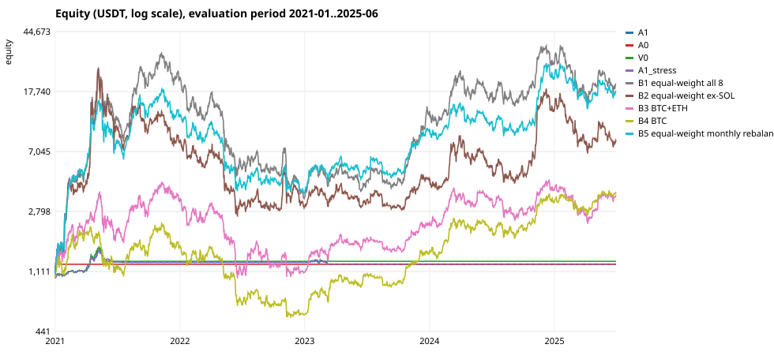
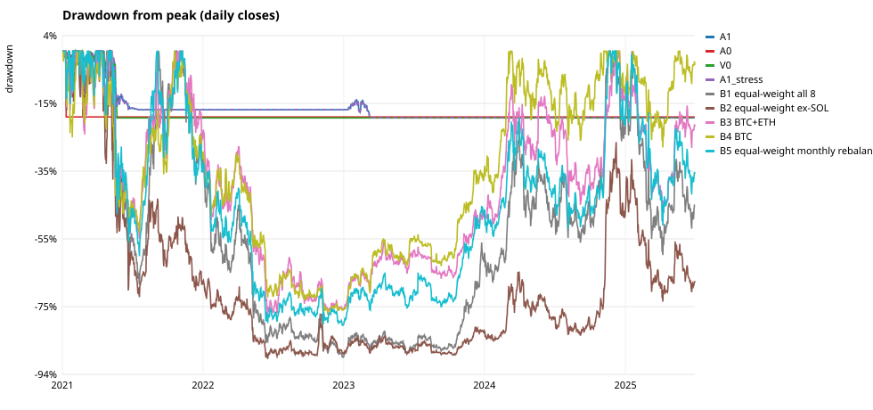
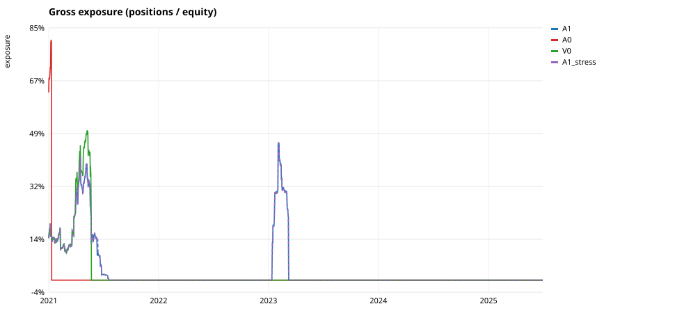

# Family A - market evaluation report (research data 2021-01-01..2025-07-01, holdout untouched)

Source: CI run 45679466940, commit 7058aa4 (protocol v5 + amendment A1). One run, nothing repeated, no parameter changed.
NOT validation: research data, survivor-biased 8-pair universe, 43 trials in the ledger.

## Side by side (base costs, breaker ON for A1/A0/V0)

| | net | annualised | max DD | Sharpe | Sortino | PF | episodes | time in market | avg / peak exposure |
|---|---|---|---|---|---|---|---|---|---|
| A1 | 24.4 % | 5.0 % | 20.0 % | 0.54 | 0.76 | 5.18 | 14 | 15.6 % | 3.0 % / 46.9 % |
| A0 | 24.0 % | 4.9 % | 22.0 % | 0.44 | 0.70 | inf | 7 | 0.6 % | 0.5 % / 81.8 % |
| V0 | 30.0 % | 6.0 % | 20.4 % | 0.59 | 0.80 | 8.10 | 8 | 8.7 % | 2.0 % / 51.2 % |
| A1_stress (2x costs) | 24.1 % | 4.9 % | 20.1 % | 0.53 | 0.76 | 5.04 | 14 | 15.6 % | 3.0 % / 46.8 % |
| B1 equal-weight all 8 | 1896.5 % | n/a | 89.7 % | 1.16 | 1.81 | n/a | n/a | n/a | passive, no breaker or cap |
| B2 equal-weight ex-SOL | 721.3 % | n/a | 90.9 % | 0.95 | 1.57 | n/a | n/a | n/a | passive, no breaker or cap |
| B3 BTC+ETH | 253.0 % | n/a | 79.4 % | 0.75 | 1.09 | n/a | n/a | n/a | passive, no breaker or cap |
| B4 BTC | 269.4 % | n/a | 77.2 % | 0.78 | 1.16 | n/a | n/a | n/a | passive, no breaker or cap |
| B5 equal-weight monthly rebalanced | 1660.4 % | n/a | 81.6 % | 1.17 | 1.78 | n/a | n/a | n/a | passive, no breaker or cap |

T3/T4 benchmark thresholds (rule fixed in protocol v3): Sortino >= 1.81, drawdown <= min(20 %, 77.2 %).

Benchmark disclosure: B1-B5 use the same fee and slippage rates but NO participation cap and NO circuit breaker. Definitions unchanged.

## T1-T10 matrix (pass / FAIL / not evaluated)

| id | criterion | threshold | A1 | A0 | V0 |
|---|---|---|---|---|---|
| T1a | closed trades | >= 200 | FAIL (14.000) | FAIL (7.000) | FAIL (8.000) |
| T1b | max single-pair share of net profit | <= 0.3 | FAIL (0.499) | FAIL (0.468) | FAIL (0.507) |
| T2 | net return after base costs | > 0 | pass (0.244) | pass (0.240) | pass (0.300) |
| T3 | Sortino vs benchmark | >= 1.806 | FAIL (0.762) | FAIL (0.699) | FAIL (0.798) |
| T4 | max drawdown | <= 0.200 (min of 0.2, benchmark) | FAIL (0.200) | FAIL (0.220) | FAIL (0.204) |
| T5 | profit factor | >= 1.3 | pass (5.176) | pass (inf) | pass (8.095) |
| T6 | stress: net return and profit factor | > 0 and >= 1.0 | pass ([0.24136116878304636, 5.0370) | not evaluated | not evaluated |
| T7a | share of windows with positive return | >= 0.6 | FAIL (0.111) | FAIL (0.111) | FAIL (0.111) |
| T7b | largest window share of total profit | <= 0.5 | FAIL (1.175) | FAIL (1.000) | FAIL (1.000) |
| T8 | profit factor per regime with enough trades | >= 0.8 where trades >= 30 | pass (all ok) | pass (all ok) | pass (all ok) |
| T9 | share of parameter variants with net return > 0 | >= 0.75 | not evaluated | not evaluated | not evaluated |
| T10 | bias checks clean (lookahead + recursive) | True | pass (1.000) | pass (1.000) | pass (1.000) |

T6 was evaluated for A1 only (the only stress run); T9 for none (no parameter sweep). T10 = causality checks (below).

## Statistics (rules fixed in protocol_v4_stats.json)

| | annualised Sharpe | 95 % block-bootstrap CI | DSR (N=43) | p(Sharpe>0) | detectable Sharpe (power 0.8) | verdict |
|---|---|---|---|---|---|---|
| A1 | 0.54 | [-0.38, 1.64] | 0.151 | 0.139 | 1.17 | not_credible |
| A0 | 0.44 | [-0.56, 1.45] | 0.104 | 0.178 | 1.17 | not_credible |
| V0 | 0.59 | [-0.31, 1.89] | 0.195 | 0.129 | 1.17 | not_credible |
| A1_stress | 0.53 | [-0.39, 1.64] | 0.149 | 0.141 | 1.17 | not_credible |

H1 (A1 Sharpe > 0) p = 0.139; H2 (A1 > B1, paired block bootstrap) p = 0.872; Holm rejections: [False, False].
PBO (CSCV, 16 splits, A1/A0/V0) = 0.467 (threshold <= 0.25).

## Circuit breaker impact (from the ON runs; no OFF counterfactual was run)

| | halt time | equity at halt | drawdown at halt | share of period traded | days flat after liquidation | liquidation fills | candles to flat | liquidation P&L | entries blocked |
|---|---|---|---|---|---|---|---|---|---|
| A1 | 2023-03-09 21:00 | 1244 | 20.0 % | 48.6 % | 844 | 3 | 1 | -10.23 | 0 |
| A0 | 2021-01-11 16:00 | 1241 | 22.0 % | 0.6 % | 1631 | 7 | 1 | 166.83 | 0 |
| V0 | 2021-05-23 09:00 | 1300 | 20.4 % | 8.7 % | 1499 | 8 | 1 | 3.76 | 0 |
| A1_stress | 2023-03-09 21:00 | 1241 | 20.1 % | 48.6 % | 844 | 3 | 1 | -10.87 | 0 |

Liquidation fills (A1): 2023-03-09 21:00 BTC/USDT 0.0040 @ 20117.40 P&L 0.52; 2023-03-09 21:00 ETH/USDT 0.0518 @ 1413.77 P&L -0.32; 2023-03-09 21:00 LTC/USDT 0.8525 @ 75.44 P&L -10.42

## Performance by market regime (BTC daily regime, previous completed day)

| | regime | days | total return in those days | episodes opened | PF of episodes |
|---|---|---|---|---|---|
| A1 | bull | 587 | -2.5 % | 6 | 5.53 |
| A1 | bear | 319 | -2.7 % | 2 | 0.05 |
| A1 | sideways | 736 | 31.2 % | 6 | 7.16 |
| A0 | bull | 587 | 24.0 % | 7 | inf |
| A0 | bear | 319 | 0.0 % | 0 | n/a |
| A0 | sideways | 736 | 0.0 % | 0 | n/a |
| V0 | bull | 587 | -0.6 % | 2 | inf |
| V0 | bear | 319 | -3.8 % | 0 | n/a |
| V0 | sideways | 736 | 36.0 % | 6 | 5.00 |

## Costs and stress sensitivity

| | gross P&L at reference prices | net P&L | total fees+slippage | traded notional |
|---|---|---|---|---|
| A1 | 247.5 | 244.1 | 3.4 | 2287 |
| A0 | 243.3 | 240.4 | 2.9 | 1926 |
| V0 | 302.2 | 300.0 | 2.2 | 1479 |
| A1_stress | 248.2 | 241.4 | 6.8 | 2281 |

A1 at 2x costs: net 24.1 % vs 24.4 % at base costs (difference -0.3 %). Costs are negligible next to the effect of the halt.

## Windows (nine 6-month windows, return) and concentration

| | 2021-01 | 2021-07 | 2022-01 | 2022-07 | 2023-01 | 2023-07 | 2024-01 | 2024-07 | 2025-01 |
|---|---|---|---|---|---|---|---|---|---|
| A1 | 28.7 % | -0.5 % | 0.0 % | 0.0 % | -2.8 % | 0.0 % | 0.0 % | 0.0 % | 0.0 % |
| A0 | 24.0 % | 0.0 % | 0.0 % | 0.0 % | 0.0 % | 0.0 % | 0.0 % | 0.0 % | 0.0 % |
| V0 | 30.0 % | 0.0 % | 0.0 % | 0.0 % | 0.0 % | 0.0 % | 0.0 % | 0.0 % | 0.0 % |

A1 profit share by pair: DOGE/USDT 50 %, ETH/USDT 43 %, BTC/USDT 16 %, XRP/USDT 11 %, ADA/USDT -3 %, LINK/USDT -8 %, LTC/USDT -8 %

A0 profit share by pair: DOGE/USDT 47 %, ADA/USDT 20 %, ETH/USDT 17 %, SOL/USDT 8 %, BTC/USDT 5 %, LINK/USDT 4 %, LTC/USDT 0 %

V0 profit share by pair: DOGE/USDT 51 %, ETH/USDT 38 %, XRP/USDT 13 %, SOL/USDT 7 %, BTC/USDT 5 %, ADA/USDT -3 %, LTC/USDT -5 %, LINK/USDT -6 %

## Causality checks (T10 for an engine strategy)

- A1: clean = True; checks: mutation prices and volumes 2022-01-01: clean, mutation prices and volumes 2024-01-01: clean, mutation volumes only 2023-01-01: clean, restart 2023-07-01: clean
- A0: clean = True; checks: mutation prices and volumes 2022-01-01: clean, mutation prices and volumes 2024-01-01: clean, mutation volumes only 2023-01-01: clean, restart 2023-07-01: clean
- V0: clean = True; checks: mutation prices and volumes 2022-01-01: clean, mutation prices and volumes 2024-01-01: clean, mutation volumes only 2023-01-01: clean, restart 2023-07-01: clean
